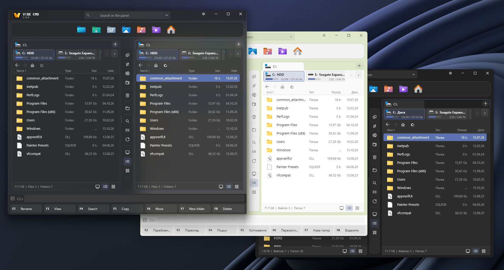
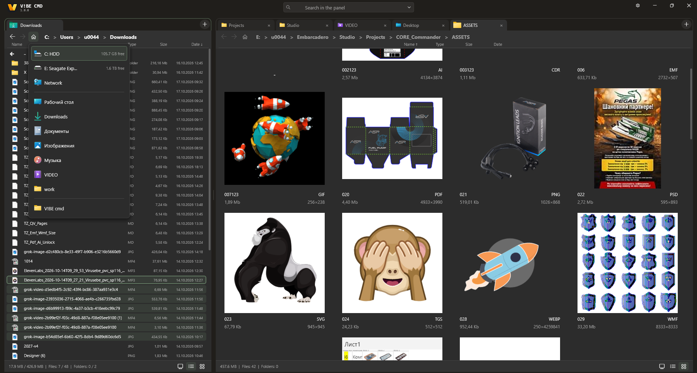
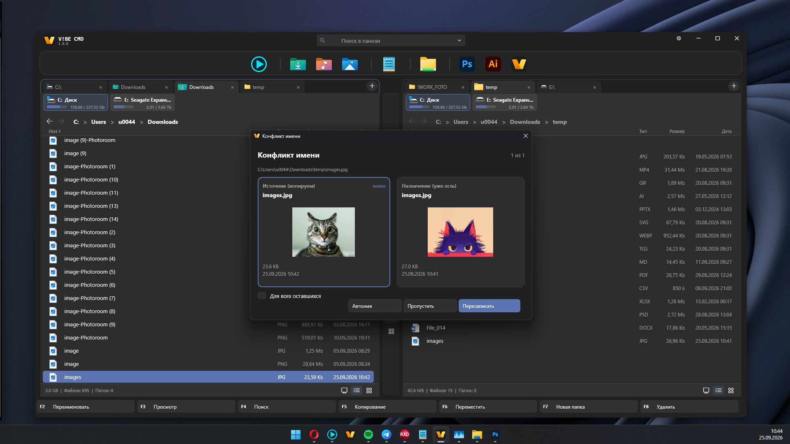
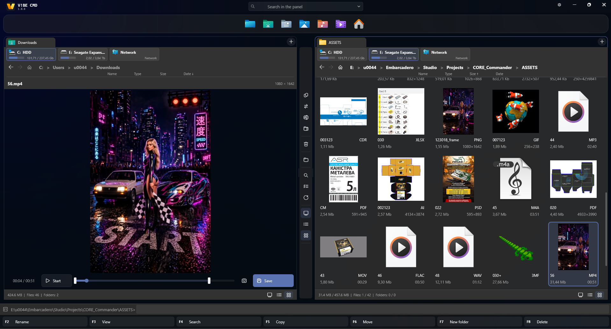
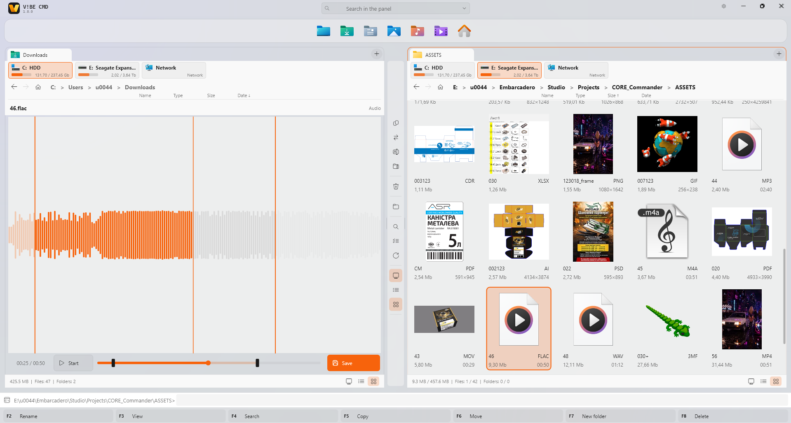
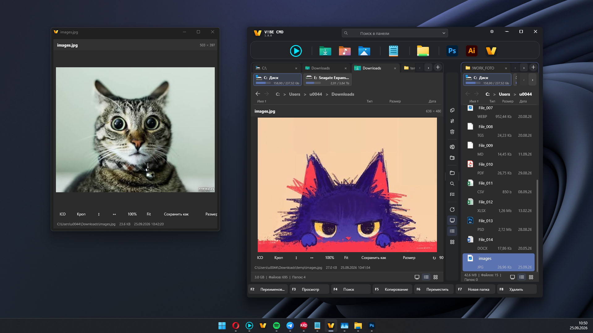
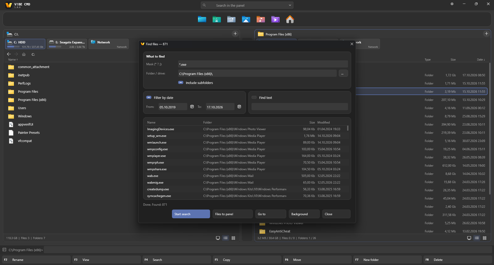
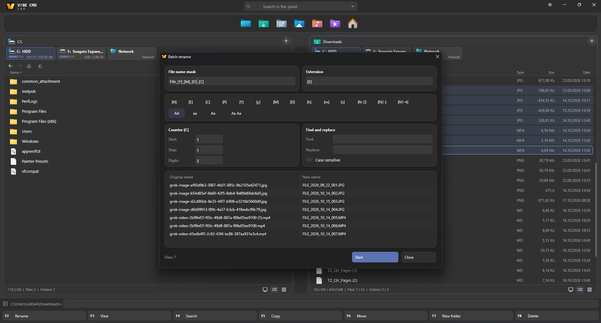
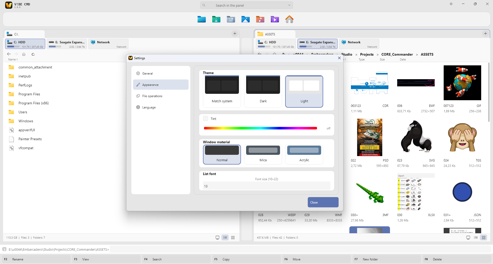
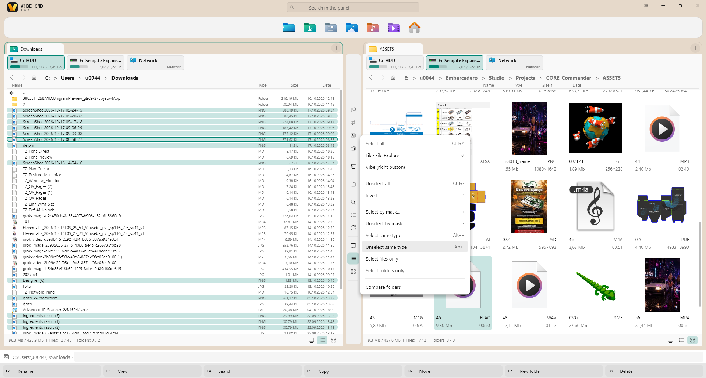

V!BE CMD
Міць класичного файлового менеджера. Зроблений для сьогодні.
Двопанельний файловий менеджер для Windows 10 і 11. Дві панелі, вкладки, справжні прев’ю і Fluent — без купи плагінів.

---
Завантаження
Публічна бета — поточна збірка:
VibeCmdBeta.zip
Розпакуйте будь-де і запустіть `VibeCmd.exe`. Інсталятора немає. Налаштування лежать поруч із програмою у файлі `VibeSetting.ini`.
> Покладіть `pdfium.dll` поруч із програмою для повноцінного показу PDF і AI. Для 7Z, RAR, CAB і ISO у системі має бути встановлений 7-Zip.
---
Що це
Провідник зручний для однієї папки. V!BE CMD потрібен, коли робота йде між двома місцями: диск і флешка, проєкт і архів, «звідки» і «куди».
Командир. Зліва джерело, справа приймач. Копіювання і перенесення дивляться на іншу панель. Активна та, де курсор.
Fluent. Власні кнопки, вкладки, картки і заголовок. Світла, темна або як у системі. Матеріал вікна: звичайний, Mica, Acrylic. Підхоплює акцентний колір Windows.
Дивитися одразу. Картинка, документ, таблиця, звук, відео, шрифт, EXE, статистика папки і вміст архіву відкриваються переглядом — без окремої програми.

---
Можливості
Робота з файлами
Дві панелі з вкладками. Кожна пам’ятає свій шлях. Вкладки піднімаються при наступному запуску.
Режим «докладно» і плитки зі справжніми мініатюрами. Плавний зум.
Хлібні крихти, смуга дисків (HDD / SSD / мережа / флешка / WPD), меню «Домівка».
Виділення як у Провіднику (рамка) або як у класичному командирі (права кнопка). Маска, інверсія, той самий тип.
Копіювання, перенесення і видалення у фоні. Пауза, пропуск, скасування, у фон.
Конфлікт імені з прев’ю поруч, розміром, датою і міткою «новіше».
Мережеві шляхи без зависання вікна. Пристрої MTP / WPD як папки.
Архів відкривається як папка: ZIP, TAR, GZ нативно; 7Z, RAR, CAB, ISO через 7-Zip.

Швидкий перегляд
У сусідній панелі (`Ctrl+Q`) або окремим вікном (`F3`).
Вид	Формати
Зображення	PNG, JPEG, WEBP, BMP, GIF, ICO/CUR, HEIC/AVIF (системні кодеки)
Вектор	SVG, CDR, EPS, EMF, WMF, Lottie
Документи	PDF, AI (PDFium), DOCX, ODT, RTF — свої парсери, без Word
Таблиці	XLSX, XLSM, CSV, TSV — свій грид, без Excel
Дизайн	Композит PSD / PSB
Медіа	Відео і аудіо, хвиля, кадр
Код і текст	Моноширинний перегляд, підсвітка, кодування
Виконувані	PE: архітектура, підпис, імпорти, версія
Папки	Панорама: розбивка розміру за типом
Інструменти картинки всередині перегляду: кроп, поворот, віддзеркалення, розмір, зберегти як. Правки лишаються в пам’яті, доки ви не збережете.

Інструменти
Пошук файлів. Маска, діапазон дат, текст усередині, результати в панель.
Групове перейменування. Маски `[N] [E] [C] [Y] [M] [D]`, лічильник, регістр, знайти і замінити, живе прев’ю.
Пошук у панелі. Фільтр поточного списку під час набору.
Док. Закріпити програми, папки і файли. Свої іконки, перетягування.
Теми. Як у системі / темна / світла, звичайний / Mica / Acrylic, тонування, розмір шрифту списку.

---
Клавіші
Клавіша	Дія
`F2` / `F9`	Перейменувати
`F3`	Швидкий перегляд (вікно)
`F4` / `Alt+F7`	Пошук
`F5`	Копіювати в іншу панель
`F6`	Перенести в іншу панель
`F7`	Нова папка
`F8` / `Delete`	Видалити
`Shift+Delete`	Видалити без Кошика
`Alt+F5`	В архів
`Ctrl+Q`	Показати / сховати перегляд у панелі
`Ctrl+T` / `Ctrl+W`	Нова вкладка / закрити вкладку
`Ctrl+M`	Групове перейменування
`Ctrl+B`	Гілка каталогу
`Tab`	Змінити активну панель
`Пробіл` / `Insert`	Позначити і йти далі
`+` / `-` / `*`	За маскою / зняти / інвертувати
`Ctrl+A`	Виділити все
Нижній ряд кнопок повторює основні дії.

---
Вимоги
Windows 10 (1903+) або Windows 11
Для HEVC / частини MKV: HEVC Video Extensions зі Store або зовнішній плеєр
Для 7Z / RAR / CAB / ISO: встановлений 7-Zip
Для повних сторінок PDF / AI: `pdfium.dll` поруч із програмою
---
Статус
Публічна бета. Базові операції, швидкий перегляд, архіви, пошук і групове перейменування вже в щоденній роботі. На крайових випадках можливі шорсткості — відгуки потрібні.
Це не обіцянка замінити кожен плагін Total Commander. Мета — щоденний шлях: дві панелі, зрозумілий перегляд і операції, які не блокують вікно.
---
Зворотний зв’язок
Помилки й ідеї: тікет у цьому репозиторії.
---
Ліцензія
Бета-збірки вільні для проби. Остаточна ліцензія ще не зафіксована.
